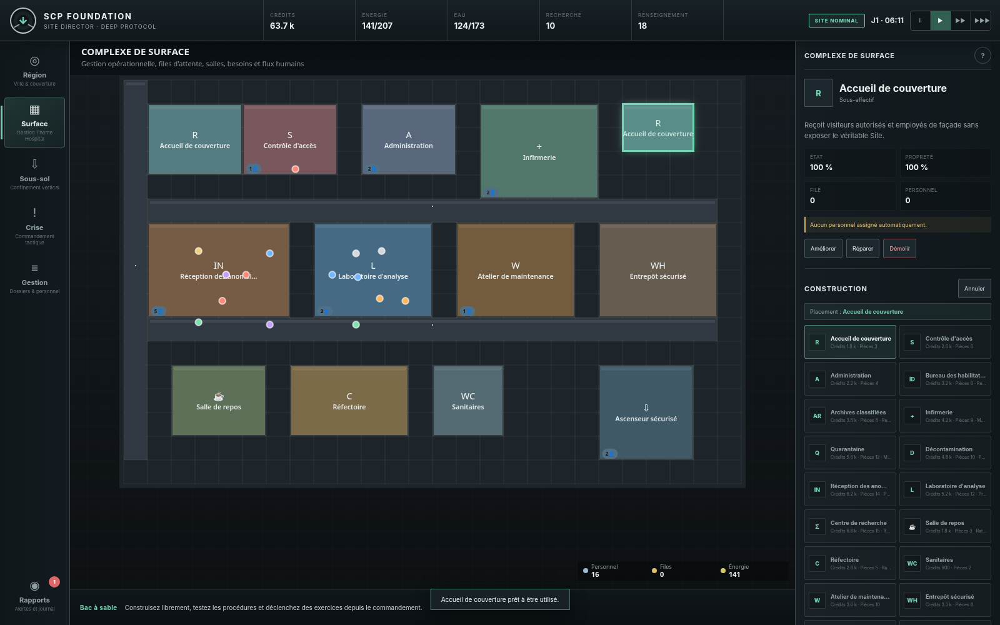

# SCP Foundation: Site Director — Deep Protocol

**Base 1.0.0 — build jouable hors ligne, tranche Operations : région, intérieurs d’annexes et réseau souterrain multi-axes**  
City-builder régional, gestion opérationnelle du complexe de surface, confinement vertical souterrain et commandement tactique de crise.



## Ce qui est livré

Cette version transforme le concept initial en un jeu web complet et jouable, sans dépendance d’exécution ni asset externe. La simulation relie réellement les quatre échelles du Site :

- **Région** : couverture publique, routes, énergie, eau, logistique, logements et suspicion.
- **Complexe de surface** : construction pièce par pièce, personnel, files d’attente, entretien, diagnostic, décontamination et réception des anomalies.
- **Niveaux inférieurs** : excavation, cellules spécialisées, réseaux critiques, transferts SCP et procédures de confinement.
- **Commandement** : crises en temps réel avec pause, ordres tactiques, intégrité du Site, maintien du Voile et pertes humaines.

Le build contient notamment :

- 14 installations régionales ;
- 25 types de salles de surface ;
- 18 modules souterrains ;
- 12 SCP jouables, chacun avec contraintes et incidents spécifiques ;
- 12 recherches interconnectées ;
- personnel individuel, métiers, traits, besoins, salaires, formation et compromission ;
- économie, énergie, eau, stocks, maintenance, propreté et files de service ;
- éditeur de procédures de confinement avec conformité et complexité ;
- campagne en 6 directives et mode bac à sable ;
- événements à choix, inspections, brèches, biohazards, infiltrations et exercices ;
- sauvegarde locale, autosauvegarde, export/import JSON, PWA hors ligne ;
- interface responsive pour ordinateur, tablette et mobile ;
- audio procédural, contraste renforcé et réduction des animations.

La représentation est une **3D stylisée en 2.5D/isométrique par Canvas** : région en perspective, surface en plan de gestion et souterrain en coupe latérale. L’architecture est prête pour une future couche WebGL réellement volumétrique sans devoir réécrire la simulation.

## Accès de surface — tranche Operations

Les salles de surface disposent maintenant de portes et de sas placés sur leurs murs. Le panneau **Portes et sas** permet de choisir l'emplacement, l'habilitation minimale, les flux autorisés et le sens de circulation. Le personnel emprunte réellement les passages autorisés ; un refus d'accès arrête son trajet et apparaît dans sa fiche.

Les sas traitent une personne à la fois, dans l'ordre d'arrivée, avec admission, égalisation et sortie. Une panne d'électricité ou d'air ferme les deux portes et suspend le cycle. L'évacuation manuelle replace l'occupant du côté d'origine et verrouille le passage, sans compter de traversée. La file, le cycle et le compteur sont sauvegardés.

Les sauvegardes antérieures reçoivent des portes compatibles sans remplacer leurs salles ni leur personnel. Les réglages d'accès s'appliquent à chaque passage : sécuriser une salle exige de configurer tous ses accès.

Cette tranche conserve la version de base 1.0.0. Les portes/sas et les déplacements souterrains sont désormais intégrés. Le dessin libre des salles, les flux autonomes de public/fret/SCP et les autres systèmes de la version Operations complète restent dans la feuille de route.

## Circulation souterraine physique — tranche Operations

Depuis le 30 octobre 2026, les déplacements des agents utilisent les **galeries réellement construites** et non une téléportation. Deux modules au même niveau doivent se toucher pour permettre le passage ; deux puits sont reliés verticalement uniquement s'ils sont alignés sur des niveaux consécutifs. Un module désactivé, dégradé ou scellé coupe la route. Les itinéraires sont recalculés lorsque la topologie ou les autorisations changent.

Le personnel rejoint un **ascenseur accessible en surface**, descend pendant quatre minutes de simulation, puis marche à **0,55 unité de plan par minute** sur la carte souterraine ; une panne électrique suspend le transfert. Plusieurs puits peuvent proposer des itinéraires alternatifs. Les niveaux d'habilitation de la salle de destination **et des modules traversés** sont contrôlés. Pour remonter et rejoindre ses besoins de surface, un agent marche jusqu'à un puits et reprend un trajet vertical temporisé. Un équipier encore en trajet ne contribue pas à la conformité d'un confinement SCP.

Dans la vue **Sous-sol**, sélectionner un module permet de voir son habilitation, son lien vers un ascenseur et l'état de sa galerie, puis de **sceller / rouvrir le secteur**. Le plan montre les raccords physiques utilisables. Les sauvegardes reprennent les déplacements en cours sans modifier leur schéma de compatibilité.

**Validation :** [92 tests métier et 17 scénarios navigateur réussis le 30 octobre 2026](docs/qa/2026-10-30/UNDERGROUND_NETWORK.md). Le jeu reste basé sur la version 1.0.0 ; la version Operations 1.1 complète n'est pas déclarée livrée.

## Un même Site, trois vues liées — tranche Operations (30 octobre 2026)

**Région / ville :** le bâtiment principal, situé au sud-est de la carte, affiche les **toitures réellement dérivées** de chaque salle du complexe de surface. Les installations régionales distinctes (centrale, dépôt, parking, couverture, voirie) restent des **annexes extérieures**. La parcelle du bâtiment principal est réservée : on construit ses salles dans la vue Surface. Sélectionnez une toiture pour retrouver la même salle, le même identifiant et la même emprise dans l'intérieur du Site. Construire ou démolir une pièce actualise aussitôt sa toiture, sans seconde liste de bâtiments divergente.

**Surface / intérieur :** le plan au sol correspond exactement aux toitures de la vue régionale par une projection isométrique inversible. La ligne jaune **A-A** indique la coupe longitudinale utilisée pour la représentation souterraine. Les puits reliés sont marqués à l'emplacement effectif de leur ascenseur. Le panneau d'une pièce permet d'ouvrir sa toiture dans la vue Région et, si elle traverse l'axe A-A, sa position souterraine.

**Sous-sol :** une bande au-dessus du premier niveau montre les vraies pièces situées sur l'axe A-A. Un puits n'est accessible que si son débouché coïncide **dans la même coupe** avec l'emprise d'un ascenseur de surface actif. Les agents conservent les déplacements physiques et les retours temporisés introduits auparavant. La vue souterraine reste une **coupe 2.5D horizontale et verticale**, et non un volume 3D complet : une pièce de surface hors de A-A n'a volontairement pas de faux module à son aplomb.

**Sauvegardes :** aucun identifiant de salle ni bâtiment miroir n'a été ajouté aux sauvegardes. Les annexes des anciennes parties qui recouperaient exceptionnellement la nouvelle emprise ne sont pas déplacées ni supprimées. Les anciennes parties restent importables selon le schéma de validation actuel.

**Vérification :** 101 tests métier et 18 étapes navigateur Chromium réussis pour le lot fonctionnel, sans erreur console. [Rapport QA des vues liées](docs/qa/2026-10-30/THREE_VIEW_SPATIAL_CONTINUITY.md). La base du jeu demeure **1.0.0** ; cette tranche ne signifie pas que toute la version Operations 1.1 est terminée.

## Annexes explorables et sous-sol sur trois coordonnées — tranche Operations

Le plan régional **reste la vue extérieure du même territoire**. En sélectionnant un bâtiment régional exploitable (centrale, eau, dépôt, etc.) puis **Explorer l’intérieur**, on ouvre désormais son plan intérieur, distinct de celui du bâtiment principal. Chaque annexe affiche **quatre zones fonctionnelles schématiques et inspectables**, dérivées de son type, de son niveau et de son état réels. Un clic choisit une zone et décrit son usage. Les routes et espaces verts ne sont pas présentés comme des bâtiments habitables. **Attention : ces pièces d’annexe sont consultatives** : elles ne sont pas encore des pièces librement constructibles, ni des salles possédant des employés/pathfinders indépendants. Les ressources proviennent toujours de l’installation régionale d’origine, sans double comptage.

La simulation souterraine n'est plus limitée au seul trait de coupe A-A. Chaque module peut avoir trois coordonnées : **x, Y (coupe transversale) et profondeur**. Depuis la vue Sous-sol, les boutons **Coupe précédente / suivante**, ou le menu **Accès direct à une coupe**, parcourent l’axe Y et la mini-carte montre tous les modules d'un **niveau sélectionné** dans un véritable plan horizontal X–Y. On peut changer la profondeur visualisée et sélectionner un module sur le plan pour retrouver sa coupe. Un module construit sur une nouvelle coupe reste à cet endroit, séparé des emprises occupées sur les autres coupes.

Les galeries se raccordent horizontalement en X, transversalement en Y lorsque leurs empreintes en X se chevauchent, et verticalement par des puits d’ascenseur alignés sur X **et** Y. Le personnel marche physiquement entre les coupes (vitesse 0,55 unité/minute), respecte les habilitations, attend les ascenseurs et peut contourner un secteur fermé par un autre itinéraire. La progression d’une jonction transversale est sérialisée pour reprendre après sauvegarde. Un accès de surface ne donne un accès souterrain que si son puits émerge réellement **sous son ascenseur à ces deux coordonnées**.

**Compatibilité :** les anciens modules souterrains sans coordonnée Y sont migrés sur la coupe initiale (Y=14 pour le plan de départ), sans déplacer les SCP ou reconstruire les salles. La validation de chargement accepte les anciens schémas reconnus et refuse les jonctions inventées ou coordonnées invalides ; le marqueur de schéma passe à 4. L'intérieur d'une annexe sélectionnée se conserve au rechargement.

Le jeu est toujours rendu en **2.5D avec coupe et mini-carte 2D** : il possède désormais une topologie et une navigation tridimensionnelles, **pas** un affichage WebGL 3D volumétrique ni des étages d'annexes modélisés en 3D. Des sas souterrains configurables, véritables portes de traversée, occupation détaillée des annexes et agents passant entre bâtiments restent à développer.

**Tests :** **119/119 tests métier** (17 nouveaux tests de réseau et d'annexes, plus une régression sur le menu Surface), **20/20 étapes Chromium**, aucune erreur console. La validation complète et le paquet jouable sont consignés dans le [rapport QA](docs/qa/2026-10-30/THREE_AXIS_UNDERGROUND_AND_ANNEXES.md). La base reste 1.0.0 ; Operations 1.1 complète n'est pas déclarée livrée.

## Lancement rapide

### Archive avec le build fourni

Le paquet cumulatif contient le code, un dossier `dist/` jouable, le rapport navigateur, les captures et des empreintes SHA-256. Avec Node.js 18 ou plus récent, lancer `npm start` depuis le dossier extrait, puis ouvrir `http://127.0.0.1:4173`. La recompilation n'est nécessaire que pour modifier les sources.

Le workflow GitHub Actions produit l'artefact **scp-operations-package** après la réussite des tests. `release/BUILD_INFO.json` identifie le commit et le bundle ; `release/FILES_SHA256SUMS.txt` décrit les fichiers de l'archive. Le `SHA256SUMS.txt` historique à la racine conserve son rôle de provenance de l'archive initiale.

### Windows

Double-cliquer sur :

```text
Lancer_Site_Director.bat
```

### macOS ou Linux

```bash
chmod +x launch_site_director.sh
./launch_site_director.sh
```

### Lancement manuel

Node.js 18 ou plus récent est requis pour le petit serveur local :

```bash
npm install
npm run build
npm start
```

Puis ouvrir `http://127.0.0.1:4173`.

Le dossier `dist/` est autonome et peut être publié tel quel sur Vercel, Netlify, GitHub Pages ou tout hébergement statique.

## Contrôles

| Action | Souris / tactile | Clavier |
|---|---|---|
| Déplacer le curseur de grille | Pointer ou toucher | Flèches, `Home` pour recentrer |
| Sélectionner / construire | Clic ou toucher | `Entrée` sur le Canvas |
| Déplacer la caméra | Glisser | — |
| Zoomer | Molette | Canvas focalisé : `+`, `-`, `PageUp`, `PageDown` |
| Région | Navigation latérale | `1` |
| Surface | Navigation latérale | `2` |
| Sous-sol | Navigation latérale | `3` |
| Commandement | Navigation latérale | `4` |
| Gestion | Navigation latérale | `5` |
| Pause / reprise | Barre supérieure | `Espace` |
| Accélérer | Barre supérieure | `+` |
| Ralentir | Barre supérieure | `-` |
| Annuler construction / fermer | Bouton Annuler | `Échap` |

## Première partie recommandée

1. Lancer une **campagne en difficulté Standard**.
2. En Région, développer la couverture, l’énergie, l’eau et les approvisionnements.
3. En Surface, compléter les flux essentiels : accueil, contrôle, médical, maintenance, entrepôt, recherche et ascenseur.
4. En Sous-sol, créer les galeries, puits, postes de sécurité et cellules compatibles.
5. Dans Gestion, recruter les rôles manquants et lancer les recherches prioritaires.
6. Transférer un premier SCP, ouvrir son dossier et ajuster sa procédure jusqu’à dépasser 75 % de conformité.
7. Depuis Commandement, déclencher un exercice lorsque les équipes et réseaux sont prêts.

## Sauvegardes

- **Sauvegarde manuelle** depuis le menu Gestion.
- **Autosauvegarde** périodique et à la fermeture de la page.
- **Export JSON** pour archiver ou transférer une partie.
- **Import JSON** avec validation, bornage, migration et normalisation des anciens champs.
- **Continuer/Charger** choisit la copie la plus récente entre sauvegarde manuelle et autosauvegarde, selon son horodatage.

Clés locales utilisées :

```text
scp-site-director-save-v1
scp-site-director-autosave-v1
```

## Build, validation et tests

```bash
npm run build
npm run check
npm test
```

`npm test` reconstruit le bundle TypeScript, exécute tous les tests métier de `tests/*.test.mjs` et contrôle la structure publiable, les icônes PWA, la licence et l'attribution. Les scénarios couvrent aussi les règles d'accès, les files et cycles des sas, les pannes et la validation des sauvegardes.

Test navigateur complet facultatif, si Python et Playwright sont disponibles :

```bash
python tests/smoke.py
```

Le rapport du passage courant et les captures sont écrits dans `test-results/smoke/`, puis téléversés par la CI. Le navigateur utilise un serveur HTTP et le stockage natif, avec reprise après rechargement, fermeture complète et perte du réseau. Les fichiers historiques dans `tests/` restent des preuves datées.

## Structure du dépôt

```text
.
├── src/
│   ├── types.ts          # modèle de données
│   ├── data.ts           # catalogue de contenu
│   ├── utils.ts          # fonctions partagées
│   ├── access.ts         # passages, profils et cycles des sas
│   ├── state.ts          # création, sauvegarde et actions
│   ├── simulation.ts     # économie, agents, SCP et crises
│   ├── renderers.ts      # vues Canvas multi-couches
│   ├── ui.ts             # panneaux, modales et interactions
│   └── main.ts           # boucle de jeu, caméra et audio
├── public/               # manifeste, icône et service worker
├── dist/                 # build directement publiable
├── scripts/              # build, serveur et validation
├── tests/                # smoke test et captures
├── docs/                 # GDD, manuel, architecture, QA et suite Codex
├── index.html
├── styles.css
└── package.json
```

## Documents importants

- [Document de game design complet](docs/GAME_DESIGN_DOCUMENT.md)
- [Manuel du directeur de Site](docs/USER_MANUAL.md)
- [Architecture technique](docs/ARCHITECTURE.md)
- [Catalogue du contenu](docs/CONTENT_CATALOG.md)
- [Rapport QA](docs/QA_REPORT.md)
- [Notes de version](RELEASE_NOTES.md)
- [Feuille de route](docs/ROADMAP.md)
- [Prompt cumulatif pour poursuivre avec Codex](docs/PROMPT_CODEX_CONTINUATION.md)
- [Attributions SCP](ATTRIBUTION.md)
- [Licence](LICENSE.md)

## Publication Vercel

Le fichier `vercel.json` est déjà configuré pour servir `dist/`. Après import du dépôt :

```text
Build command : npm run build
Output directory : dist
```

## Positionnement de la version 1.0

Cette version est une simulation de gestion complète et jouable, pensée comme un **socle de production**. Elle ne prétend pas être déjà un jeu commercial 3D à gros budget : les personnages, salles et incidents sont représentés de façon procédurale en 2.5D, afin de concentrer le développement sur la profondeur systémique, la stabilité et l’interconnexion du gameplay. La feuille de route prévoit le rendu WebGL, l’éditeur de salles volumétriques, le modding et davantage de SCP sans casser les sauvegardes existantes.

## Licence et attribution

Le projet dérive de contenus de l’univers SCP Foundation. Voir `LICENSE.md` et `ATTRIBUTION.md` avant toute redistribution ou modification. Aucun visuel, son ou fichier média du wiki SCP n’est intégré au build : l’interface, les symboles et les rendus sont générés localement par le projet.

