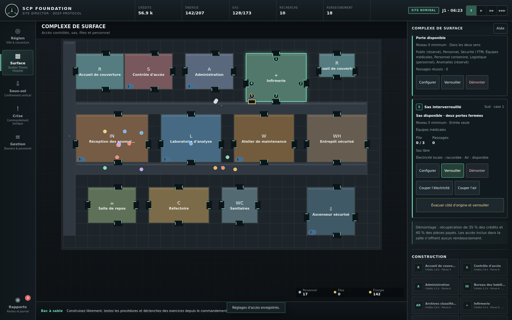
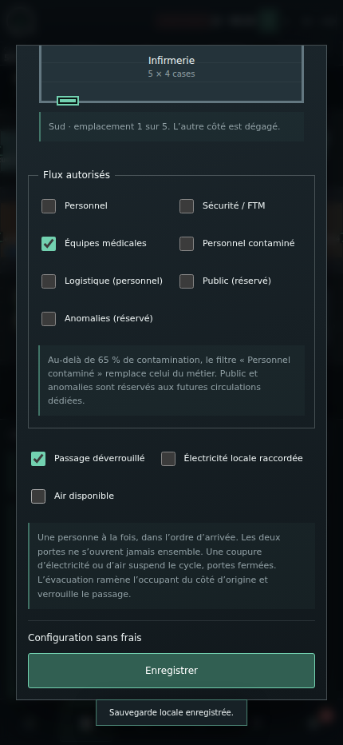

# Validation — portes et sas de surface

Date : 29 octobre 2026. Édition : **Operations — Accès de surface**. Version de base : **1.0.0**.

## Résultat

La tranche est appliquée, compilée et validée : **83 tests métier réussis sur 83**, **16 étapes navigateur réussies sur 16**, aucun message d'erreur dans le rapport navigateur. L'archive cumulative a été générée puis vérifiée.

- [Commit fonctionnel validé](https://github.com/darknigthmare/scp-foundation-site-director/commit/01e503ea9bfa1bf11a62dcb690cabc859146cbce)
- [Exécution complète de la CI](https://github.com/darknigthmare/scp-foundation-site-director/actions/runs/40933133552)
- [Archive cumulative de cette exécution](https://github.com/darknigthmare/scp-foundation-site-director/actions/runs/40933133552/artifacts/12923857123)
- [Rapport navigateur brut](access-browser-report.json)
- [Métadonnées de vérification](access-verification.json)

Ces preuves concernent précisément le commit fonctionnel ci-dessus. Le commit qui ajoute ce dossier ne modifie pas le programme. Les exécutions ultérieures produisent leur propre archive et leur propre fichier `release/BUILD_INFO.json`.

## Fonctionnement vérifié

Les portes sont des seuils réels sur un mur de salle : emplacement, habilitation minimale, profil autorisé et sens de passage sont appliqués aux déplacements. Un changement de règle invalide les trajets. Un agent déjà engagé dans une porte qui devient interdite revient à son origine à vitesse normale, y compris après une sauvegarde et un chargement. Un passage n'est compté qu'une fois achevé.

Un sas admet un seul occupant et gère une file FIFO bornée. Les phases durent une minute simulée pour l'admission, deux pour l'égalisation et une pour la sortie. Les deux vantaux ne s'ouvrent jamais simultanément. Une coupure électrique, un manque d'air ou un verrouillage ferme les deux portes et suspend le cycle ; les tickets déjà en attente conservent leur ordre et leur échéance. L'évacuation renvoie l'occupant du côté d'origine et verrouille l'accès sans compter de passage. Un cycle valide reprend après chargement.

Les achats sont atomiques : 250 crédits et 2 pièces pour une porte ; 1 000 crédits et 6 pièces pour un sas. La configuration est gratuite. Le démontage récupère 35 % des crédits et 40 % des pièces effectivement payés ; les accès initiaux gratuits ne créent aucun remboursement. Les files, occupants et contraintes de modification sont également contrôlés pendant la pause.

Le schéma de sauvegarde porte maintenant le marqueur 3. Les versions antérieures compatibles sont migrées ; les références incohérentes, valeurs invalides et schémas futurs sont refusés. Les anciennes salles dépourvues d'accès reçoivent des entrées compatibles ; une liste d'accès explicitement vide reste vide.

## Validation technique

| Vérification | Résultat |
| --- | --- |
| Installation reproductible `npm ci` dans GitHub Actions | Réussie |
| Compilation TypeScript stricte | Réussie, TypeScript 5.9.3 |
| Tests métier `npm test` | 83/83 |
| Validation structurelle du build | Réussie |
| Parcours Chromium automatisé | 16/16 étapes |
| Erreurs consignées par le scénario navigateur | 0 |
| Égalité du build suivi et du build produit en CI | Exacte pour JS, CSS et service worker |
| Archive ZIP | CRC, empreinte et 95 fichiers du manifeste vérifiés |

Les 83 tests comprennent les 42 scénarios préexistants, 25 scénarios de navigation et de sas et 16 scénarios d'état/sauvegarde. Ils couvrent notamment les habilitations et sens, le retour en cours de franchissement, l'absence de contournement par les corridors, les files et pannes à chaque phase, la reprise, les formations payées pendant le transit, les coûts/remboursements, les références invalides et le repli sur une sauvegarde valide.

Une compilation réelle avec la version verrouillée du compilateur, chargée en mémoire, a aussi permis d'exécuter les tests avant envoi. Les essais Chromium ont été exécutés **dans GitHub Actions**, pas dans l'environnement local de travail.

### Parcours navigateur

Le [rapport JSON](access-browser-report.json) conserve les 16 étapes et leurs résultats. Le scénario vérifie :

- le chargement, une nouvelle partie, la construction dans les trois vues et un transfert SCP compatible ;
- la gestion du personnel, la recherche et une procédure ;
- l'installation et la configuration d'un sas dans l'interface, les coûts, les autorisations et le verrouillage ;
- un cycle réel obtenu du moteur, sauvegardé puis importé et rechargé, avec attente du compteur de passage effectif ;
- les sauvegardes manuelles, le rechargement HTTP, la fermeture complète du navigateur et la reprise hors ligne via le cache PWA ;
- la crise, un ordre tactique et l'interface mobile ;
- l'éditeur tactile des accès, l'électricité locale et l'air.

Le navigateur utilise un profil Chromium persistant natif. La vue mobile est un viewport Chromium de 430 × 932 pixels ; elle ne constitue pas un essai sur un téléphone physique ou dans Safari.

## Contrôle visuel

Les deux images produites par la CI ont été ouvertes et examinées. La capture de bureau montre les accès aux limites des salles, leur numérotation, les commandes du sas et les informations de file et d'alimentation. La capture mobile montre le formulaire défilé jusqu'aux autorisations et aux alimentations : textes lisibles, cases et bouton Enregistrer accessibles, sans dépassement horizontal apparent. Les contrôles automatisés vérifient également la largeur du formulaire.

### Bureau — 1600 × 1000



### Mobile — 430 × 932



## Provenance et intégrité

GitHub Actions a testé le commit de fusion synthétique `f7a428a2e1ce72bec697ec61ea4a2a61afb517f5`. Son arbre Git est exactement celui du commit fonctionnel livré : `e2420077c72189ffbab7d357bb3652667aab2eec`. Le contenu source testé correspond donc au contenu livré.

Le fichier `release/BUILD_INFO.json` de l'archive enregistre ce commit de fusion réellement extrait, le numéro d'exécution et le SHA-256 du programme. Il ne faut pas le confondre avec le SHA du commit de branche.

| Fichier | SHA-256 |
| --- | --- |
| `dist/game.js` | `9ebcfdc385ab093d7c37fc20f932d353a3146a32846c501ba0dd5212f9b08aed` |
| `dist/styles.css` | `f17527923ae1f6b221e64d43fe4950f50fe8fdba450c8177cdcc8263e2846162` |
| `dist/service-worker.js` | `4701bc012789ae58bc3a5b0bd83cbafca855bc094bbd6694517ae25146e8bbbc` |
| `scp-builder-operations-access.zip` de l'exécution 40933133552 | `45a6daea1761f9b40f76de45ddf0e78c034c22ee465879a8421ec38c5966d681` |

Le paquet contient 96 fichiers, dont un manifeste couvrant les 95 autres fichiers. L'empreinte extérieure de l'artefact GitHub a aussi été vérifiée avant ouverture. La rétention des artefacts CI est de 14 jours ; les sources et ce dossier de preuves restent dans le dépôt. Un paquet généré après l'ajout de ces preuves possède naturellement une autre empreinte.

## Utilisation du paquet

Télécharger l'artefact `scp-operations-package`, ouvrir son ZIP, puis extraire `scp-builder-operations-access.zip`. Depuis la racine du dossier extrait, avec Node.js 18 ou supérieur :

```sh
npm start
```

Ouvrir ensuite [http://127.0.0.1:4173](http://127.0.0.1:4173). Le build est déjà inclus ; aucune installation de dépendances n'est nécessaire pour jouer. Les commandes de développement et de reconstruction restent décrites dans le README.

## Limites explicites

- Les règles s'appliquent au personnel de surface. Les catégories public et anomalies sont réservées à de futurs déplacements dédiés ; aucun nouveau convoi autonome n'est ajouté.
- Les transferts souterrains existants restent abstraits. Cette tranche n'ajoute pas une navigation physique souterraine, le dessin libre des salles ou un réseau physique de pression.
- La compatibilité des anciens formats est couverte par des fixtures synthétiques et les migrations connues ; toutes les sauvegardes historiques réelles n'ont pas été disponibles pour vérification.
- Les disponibilités et interrupteurs existants pilotent l'air et l'électricité des sas.
- Vercel refuse le déploiement de ce commit avec le statut `build-rate-limit`. L'aperçu préexistant affiche donc une version antérieure. La compilation et la validation réussies proviennent de GitHub Actions.
- La PR reste en brouillon et non fusionnée. Cette livraison termine la tranche des accès de surface ; elle ne déclare pas terminée toute la feuille de route Operations.
